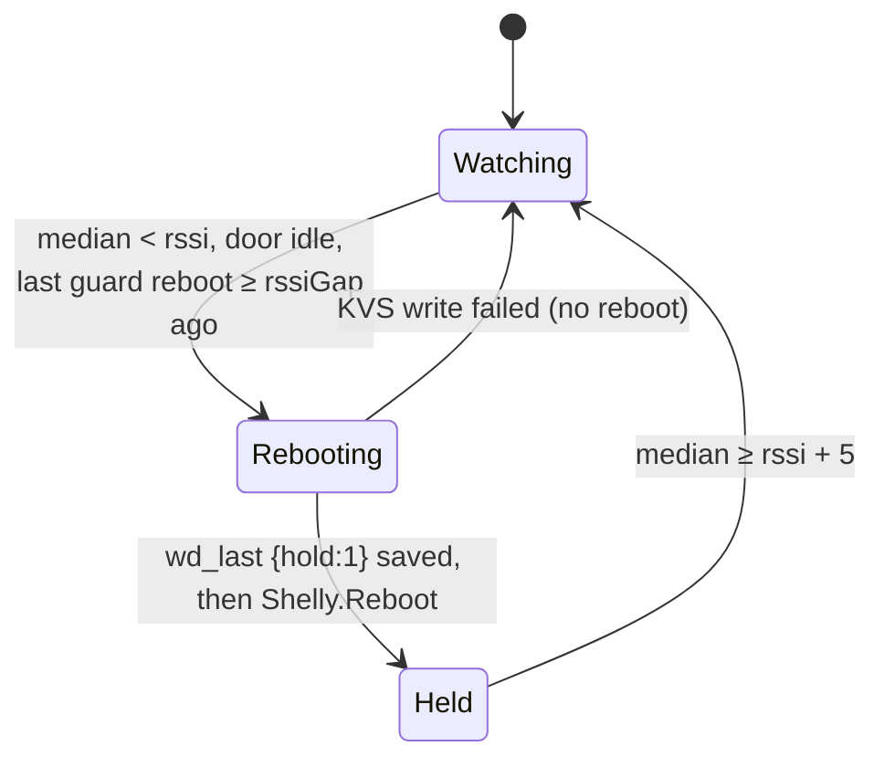

# 13 — Device resilience (connectivity watchdog + weak-signal guard)

Both device scripts carry a **connectivity watchdog**: if Wi-Fi or the broker is down for too long, reboot
to recover a wedged network/TLS stack. (NEW-PROJECT-GUIDE §4 pattern.) They also carry a
**[weak-signal guard](#weak-signal-guard)**: reboot when the Wi-Fi signal stays weak, so the device re-picks
the strongest AP.

## Why it's safe here — no resume gate

The coffee-timer had to gate resume on `reset_reason == 3` because it resumed a running countdown (a
mains loss must boot to OFF). **Our devices hold no resumable runtime state:**

- **i4 (monitor):** re-derives door state from live inputs at boot — always correct.
- **S1 (controller):** relay `initial_state:off`, never auto-acts; the door picture is repopulated by the
  next i4 push.

So **boot is always safe regardless of cause** → the watchdog needs no `reset_reason` gate and no resume
logic (D-20). It only ever reboots-to-recover. (`reset_reason` 1=power / 3=software was observed on both
devices, spec 11 — but nothing depends on it.)

## Logic

One pure function in each script (unit-tested):
```
wdReboot(wifiDownMs, mqttDownMs, cfg) -> "wifi" | "mqtt" | ""
```
The single repeating timer accumulates `wifiDown`/`mqttDown` each tick (broker-down only counts while
Wi-Fi is up and MQTT is enabled; any reconnect resets to 0) and reboots when a threshold is crossed.

- Defaults: **Wi-Fi down ≥ 600 s** or **broker down ≥ 1800 s** → `Shelly.Reboot`.
- Overridable via KVS key **`wd_cfg`** = `{"on":0|1,"wifi":<s>,"mqtt":<s>}` (read at boot). Absent → defaults.
- `mqttEnabled` comes from `Mqtt.GetConfig.enable` at boot; if MQTT is disabled the broker check is skipped.

## Command re-subscription on broker reconnect (controller)

The watchdog recovers a *wedged* stack, but it cannot recover a subtler failure: the controller stays
`mqtt.connected == true` yet silently stops receiving commands. Shelly clears a script's `MQTT.subscribe`
subscriptions when the script stops and **does not guarantee they survive a broker drop/reconnect** (the
docs only promise the connect-established handler fires on each reconnect). If a transient outage (Wi-Fi
blip, broker restart, keepalive timeout) drops and restores the link, a subscribe-once-at-boot controller
becomes **"connected but deaf"** until a manual restart — and the watchdog never fires, because
`mqtt.connected` reads back `true` (any reconnect resets `mqttDown` to 0).

**Fix (controller only — the i4 subscribes to nothing):** `subscribeCmd()` runs at boot **and again on
every MQTT down→up edge**, detected by the existing 1 s tick (`mqttUp()`), re-subscribing exactly once per
reconnect. `mqttWasUp` is seeded at boot so a steady connection never re-subscribes. Unit-tested
(`controller.test.js` — re-subscribe on transition + no steady-state churn). Latency to re-subscribe is
≤ 1 tick; a sub-second drop+reconnect entirely inside one tick window is not detected (acceptable — a blip
that brief is unlikely to have dropped the subscription). This complements the app-side gaps (fire-and-
forget QoS-1 to a **non-retained** command topic, no end-to-end ACK) — a command that lands while the
controller is briefly deaf is still lost, so the app path is the other half of the reliability story.

## Weak-signal guard

**Why (incident 2026-10-30).** The gateway was down for ~20 min. Both devices lost their IP, the Wi-Fi
watchdog rebooted them, and they came back on worse APs. The S1 then sat at −88 to −92 dBm for 6 h, while
another AP was ~17 dB better. At that level it stopped answering ARP from new LAN clients. So the app's
HTTP-direct commands failed, and so did the i4's door POSTs. The controller's door picture stayed `UNKNOWN`,
which made `stop` a no-op. MQTT commands still worked. One manual reboot put it on the best AP.

The firmware's own roaming (`roam.rssi_thr` −80, `interval` 60) never fired, and nothing documents why:
Shelly publishes no algorithm, and no changelog entry mentions roaming. A full reboot is the one thing proven
to re-pick the strongest AP. A Wi-Fi-only reconnect may reuse the same BSSID. A script can't survey the APs
either: `WiFi.Scan` hides any AP at about −85 dBm or weaker (fw ≥ 1.5.0).

**Rule (both scripts).** The guard samples `rssi` from the `wifi` status 15 times per window: `rssiWin`,
default 900 s, so one sample a minute.

- Samples without an IP are skipped. A lost IP is the Wi-Fi watchdog's job.
- An AP change (BSSID) clears the window, so a firmware roam is never answered with a reboot.
- Once the window is full, the guard works on the **median**. The i4 swings ±5 dB, so no single sample
  decides.
- The pure `rssiGuard(median, idle, now, rec, cfg) -> "reboot" | "recover" | ""` makes the decision
  (unit-tested).



- **Reboot** when the median is below `rssi` (default −85 dBm), the door is idle, the wall clock is set, and
  the last guard reboot was at least `rssiGap` ago (default 6 h).
- **Record first.** Before rebooting, the script saves KVS `wd_last` = `{ts, why:"rssi", rssi:<median>,
  hold:1}`. If that write fails, it doesn't reboot: an unrecorded reboot would escape the rate limit.
- **Hold.** A guard reboot leaves the guard held, and it won't reboot again while held. The hold clears
  once a full window's median reaches `rssi` + 5 dB (−80). A reboot that helped clears it within one window.
  If every AP is weak at that spot, the guard stays held until the signal recovers, so it can't loop.
- **Door idle.** The **S1** needs no pulse, sequence or lockout in progress, nothing queued, the relay off,
  and a door picture that isn't moving. A "moving" picture older than 120 s counts as stale: a weak signal
  kills the i4's feed, and that mustn't block its own fix. Once the S1 commits to a reboot, it drops new
  commands until it goes down, so the reboot can't cut a stop-then-reverse short. `stop` still gets through:
  it is a single pulse, and a truncated one is no worse than a dropped one. The **i4** needs its motor
  inputs idle.
- **Relay safety is unchanged.** The S1 relay boots off (`initial_state:off`, 0.5 s auto-off, set at boot).

**Config.** The guard extends KVS `wd_cfg`. Out-of-range values are ignored and the default stays.

| key | default | accepted | meaning |
|---|---|---|---|
| `rssiOn` | 1 | 0/1 | guard on/off (`on:0` turns off the whole watchdog, guard included) |
| `rssi` | −85 | −100 … −60 | threshold, dBm |
| `rssiWin` | 900 | ≥ 15 | window, s (15 samples) |
| `rssiGap` | 21600 | ≥ 60 | minimum time between guard reboots, s |

**Visibility.**

- The script `print()`s the reason when it reboots and when the hold clears.
- Both devices' `mon/<id>/alive` (every 30 s, LAN-only, spec 03) carries `rssi` and `wd: {last, why,
  rssi, hold}`. `last` is the unixtime of the last guard reboot (0 means never), and `rssi` is the median
  that triggered it. Alive is also published at once when the guard reboots and when the hold clears.
- To reset the guard, run `KVS.Delete wd_last` and restart the script.

**Limits.**

- The i4 sat at −76 to −87 dBm that day, a median around −81. The default −85 wouldn't fire there, and the
  i4 kept working. Set `rssi` higher if the i4 ever needs it.
- The i4's 100 ms tick runs slow under load, so its window is approximate.
- After any S1 reboot (guard, watchdog or power), its door picture is `UNKNOWN` until the i4's next
  re-send, which comes at most 30 s later (D-22). In that window an `open`/`close` sends one best-effort
  pulse (D-19), and `stop` is a no-op.

## Validation (2026-06-07/08)

- **Unit:** 31 device tests incl. `wdReboot` decision + an integration that reboots after the broker-down
  threshold (mocked Wi-Fi/MQTT) and *doesn't* when connected or when MQTT is disabled.
- **Hardware (i4):** with the real broker up, `mqttUp()=true`, counter stays 0 (no false reboot). Rebooted
  into a dead-broker config → `mqttUp()=false`, `WD.mqttDown` climbed monotonically; on restore the device
  reconnected and the script resumed. `wd_cfg` from KVS applied. (Threshold restored before an actual
  reboot — that path is unit-tested.)
- **Note:** under heavy `Script.Eval` polling the 50 ms monitor tick ran slightly slow, so wall-clock
  thresholds are approximate — acceptable for a recover-a-wedged-stack timer; revisit if exact timing
  ever matters.

## Known: i4 monitor CPU (~83%) — accepted (Q-14)

The i4 monitor polls its inputs every 100 ms, which costs **~83% of the script core** — confirmed real
(the coffee plug's always-on script, same fw, reads **0%** with a 30 s timer; the S1 controller reads
**4%** at 1 s). It's **accepted for now**: RAM/heap/FS margins are healthy and the device is stable.
**Mitigation if it ever matters** (more per-tick work, heat/power, or a second script on the device):

- **Event-driven** inputs — react to the i4's real `input:N` events (D-14) + a slow (1 s) housekeeping
  timer for alive/watchdog. Best: ~5% CPU and keeps fast/faithful detection (incl. brief STOPPED). Cost:
  rewrites the validated input path (re-verify via Node tests + bench door-matrix).
- **Slow the poll to ~1 Hz** — trivial, ~4% CPU, but ~2 s to confirm a state change and a brief mid-travel
  STOPPED during a 2-pulse reverse may not register.

## Tuning the threshold on the bench
```bash
# set a short broker-down threshold, restart the script so boot reads it
curl -s -X POST http://192.0.2.160/rpc -d '{"id":1,"method":"KVS.Set","params":{"key":"wd_cfg","value":"{\"on\":1,\"wifi\":86400,\"mqtt\":150}"}}'
# … induce a disconnect, observe via Script.Eval "WD.mqttDown" …
curl -s -X POST http://192.0.2.160/rpc -d '{"id":1,"method":"KVS.Delete","params":{"key":"wd_cfg"}}'   # back to defaults
```

The weak-signal guard can be exercised without moving the door. Set the threshold above the live signal and
use a short window. The device reboots once, then stays held, because −55 is never reached. Then clear both
keys and restart the script:
```bash
curl -s -X POST http://192.0.2.160/rpc -d '{"id":1,"method":"KVS.Set","params":{"key":"wd_cfg","value":"{\"rssi\":-60,\"rssiWin\":60}"}}'
# … restart the script, watch mon/<id>/alive's wd.last/hold …
curl -s -X POST http://192.0.2.160/rpc -d '{"id":1,"method":"KVS.Delete","params":{"key":"wd_cfg"}}'
curl -s -X POST http://192.0.2.160/rpc -d '{"id":1,"method":"KVS.Delete","params":{"key":"wd_last"}}'
```
